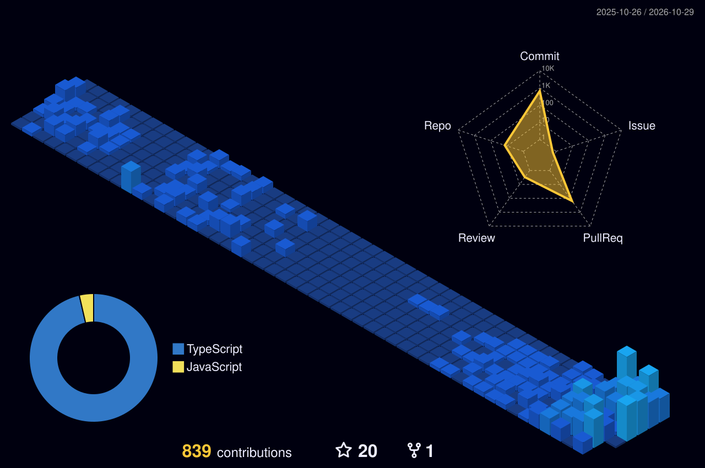

  

  
  
  
  

---

## 👋 About Me

I'm a **full-stack web developer** who builds the business software companies run on every day: **ERPs, point-of-sale systems, HR and inventory platforms**.

I started coding in college in 2021, and since then I've worked on real production systems: improving a warehouse inventory system, migrating an enterprise HR system from VB.NET to React and Express, and building a construction management and payroll system from the ground up.

I enjoy owning a product end to end, from designing the database and APIs to shipping a fast, responsive interface and keeping it running in production.

- 🔭 Currently building business software: ERP, POS and SaaS platforms
- 🧱 Focus: TypeScript, React, Express / NestJS, PostgreSQL, Docker
- 💼 Open to full-time roles and freelance work

---

## 🛠️ Tech Stack

**Front-end** 

**Back-end** 

**Database** 

**DevOps & Tools** 

Also: TanStack Query & Router, shadcn/ui, Ant Design, Hono, Socket.IO, Drizzle, SQL Server, Cloudinary, Vitest

---

## 📊 GitHub Activity

  
  

  

  

---

  <b>Let's build something together.</b> 
  Reach me through my <a href="https://jhondel-portfolio.vercel.app/#contact">portfolio contact form</a> or <a href="https://www.linkedin.com/in/jhondel-caranay-87b5ab205/">LinkedIn</a>.

